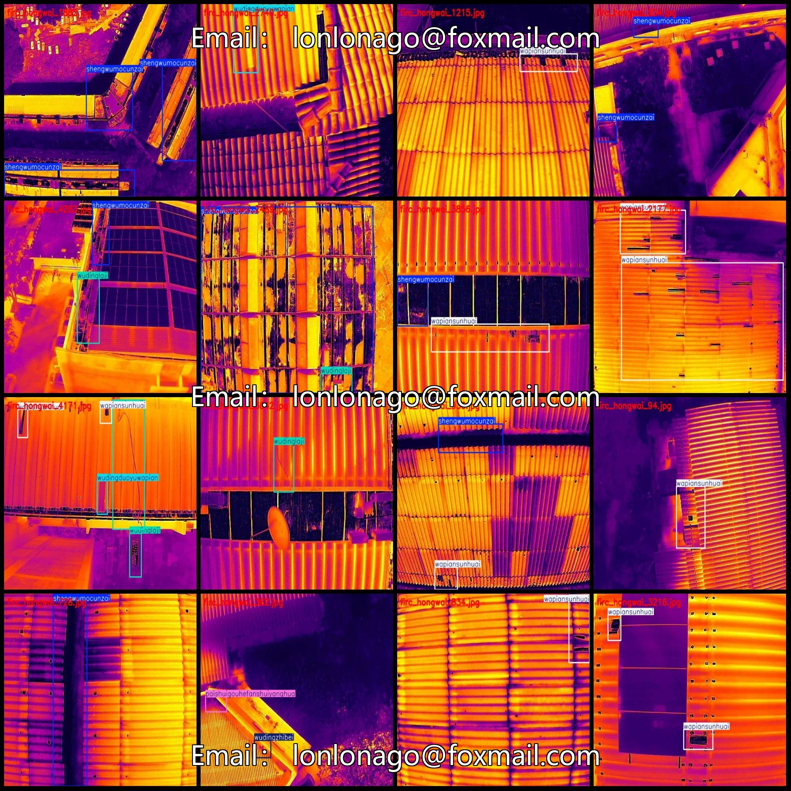
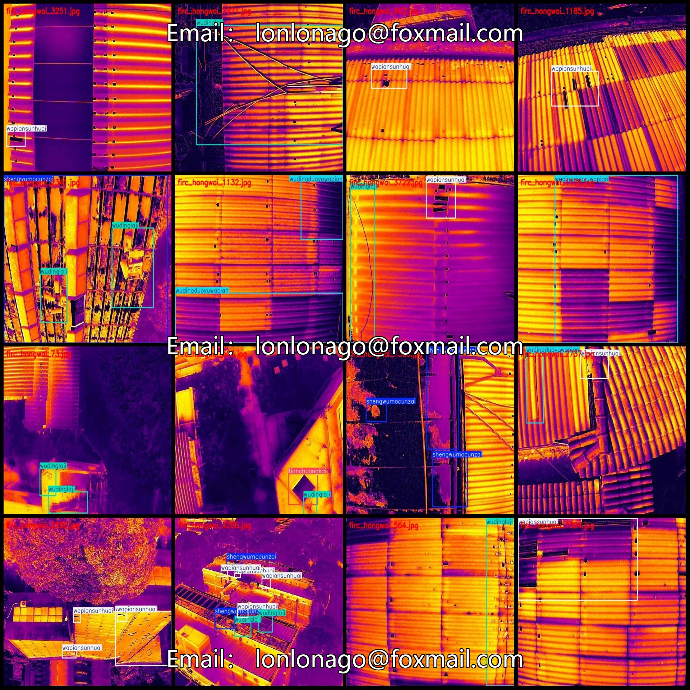
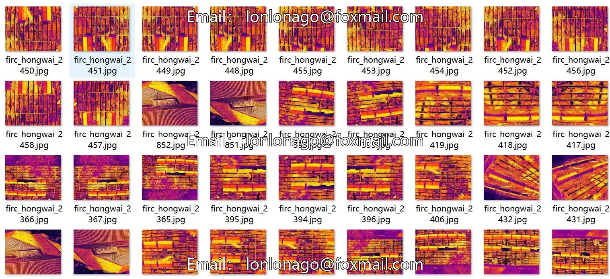
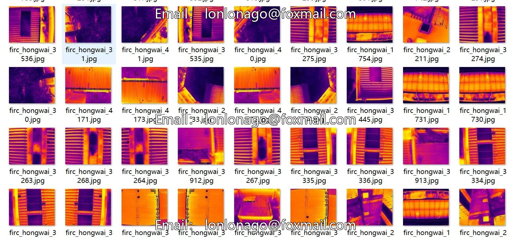

# UAV-viewpoint aerial photography infrared imagery roof defects tile damage roof trash detection dataset

## Body

Drone-view aerial photography infrared image roof defects tile damage roof trash detection dataset VOC+YOLO format 4300 images 10 categories
Warm reminder: Due to the dataset's replicability, please confirm compliance with requirements before purchasing.
Dataset format: Pascal VOC format + YOLO format (txt file without split path, only containing jpg images and corresponding VOC format xml files and yolo format txt files)
Number of images (number of jpg files): 4300
Number of annotations (number of xml files): 4300
Number of annotations (number of txt files): 4300
Number of annotation categories: 10

Label category names (Note that the order of labels in YOLO format does not correspond to this, but is based on the classes.txt file in the labels folder): ["loubanliefeng", "paishuigouhefanshuiyanghua", "shengwumocunzai", "tianchuangkai", "wapiansunhuai", "wapianyiwei", "wudingduoyuwapian", "wudinglaji", "wudingwugou", "wudingzhibei"]

Category: ["Roof Cracks", "Drain Gutters and Water Evaporation Oxidation or Depression", "Biofilm Presence", "Window Opening", "Tile Damage", "Tile Movement", "Excessive Tiles on Roof", "Roof Waste", "Roof Dust", "Roof Weeds"]
Number of boxes labeled in each category
loubanliefeng frame count = 138
Paishuigouhefanshuiyanghua frame count = 5
shengwumocunzai frame count = 3581
tianchuangkai frame count = 170
Wapian Sunhuai Frame Count = 3554

Wapianyiwei Frames = 44
Wudingduoyuwapian Frames = 675
Wudinglaji Frames = 2184
Wudingwugou Frames = 247
Wudingzhibei Frames = 354
Total Frames: 10952
Number of Images per Category
loubanliefeng Images = 109
Paishuigouhefanshuiyanghua Images = 5
Shengwumocunzai Images = 2296
Tianchuangkai Images = 133

Wapian Sunhuai occupies 1941 images
Wapianyiwei occupies 42 images
Wudingduoyuwapian occupies 505 images
Wudinglaji occupies 1312 images
Wudingwugou occupies 190 images
Wudingzhibei occupies 276 images
Image resolution: 640x512
Labeling tool used: labelImg
Labeling rules: Draw a rectangle around the category.
Important note: The dataset does not have separate training, validation, and test sets; you need to manually divide them.

Special : This dataset does not guarantee the accuracy of the trained models or weight files.

## Images

## Payment

Here is a pay link on Stripe ( https://buy.stripe.com/3cs8yP7sY87d0vu9AB ). Please contact me lonlonago@foxmail.com after funding $89, and I will send you a complete data files , thank you!

